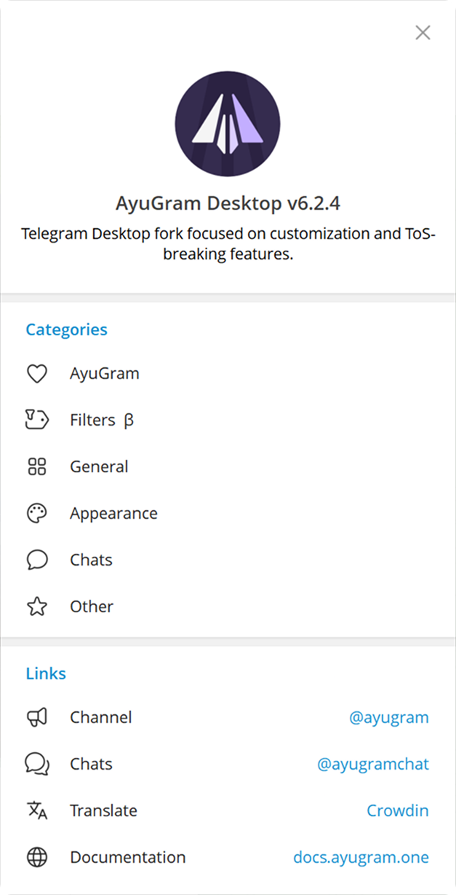
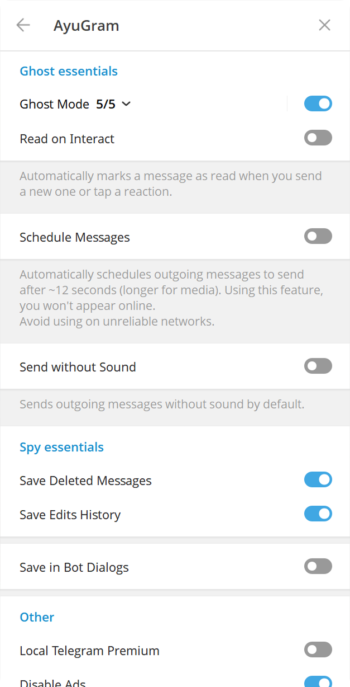
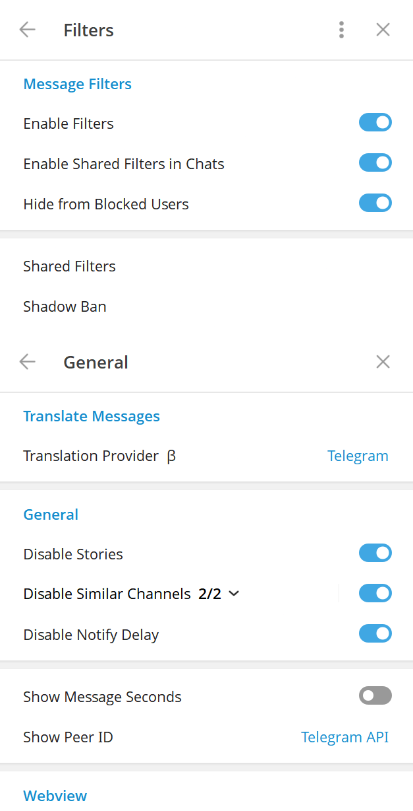
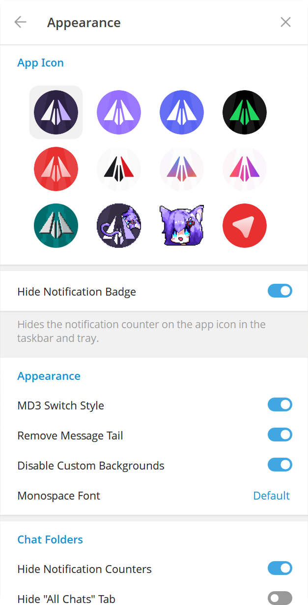
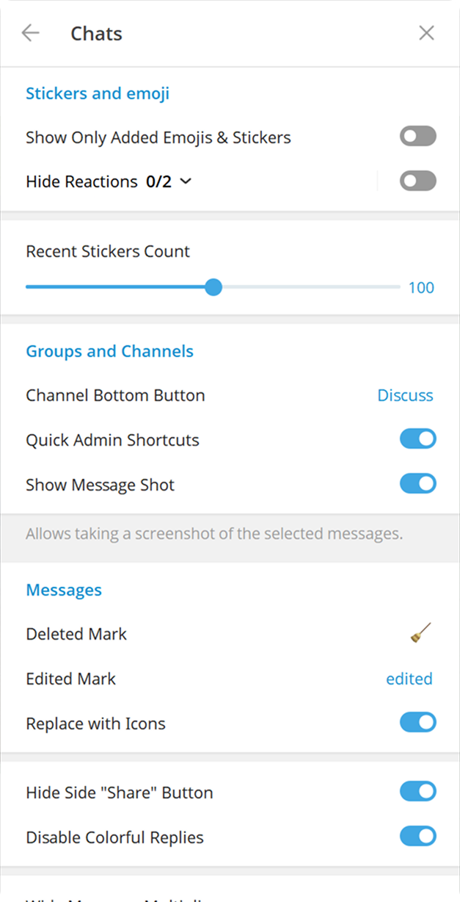

# Aqzelo Desktop


[ [English](README.md)  |  Русский ]

Функциональный форк Telegram Desktop с фокусом на приватность, кастомизацию и улучшенный UX.

## Возможности

- **Полный режим призрака** (настраиваемый) — чтение сообщений без отправки прочтений
- **История сообщений** — отслеживание удалённых/изменённых сообщений
- **Anti-Recall** — предотвращение удаления сообщений
- **Кастомизация шрифтов** — свои шрифты, размеры, масштабирование
- **Режим стримера** — скрытие чувствительной информации при стримах
- **Локальный Telegram Premium** — разблокировка премиум-функций локально
- **Встроенный переводчик** — перевод сообщений в строке
- **Превью медиа** — быстрый просмотр по принудительному нажатию (macOS)
- **Улучшенный интерфейс** — темы, анимации, пользовательский CSS

И многое другое. Посмотрите наш [FAQ](https://t.me/AqzeloFAQ) и [Канал](https://t.me/Aqzelo).

<details>
<summary>Скриншоты</summary>
<table>
  <tr>
    <td></td>
    <td></td>
    <td></td>
  </tr>
  <tr>
    <td></td>
    <td></td>
  </tr>
</table>
</details>

## Установка

### Windows

#### Официальные релизы
Скачайте готовые бинарники со вкладки [Releases](https://github.com/motelyz/aqzelo/releases) или из [Telegram-канала](https://t.me/AqzeloReleases).

#### Менеджеры пакетов
```bash
# Winget
winget install RadolynLabs.AqzeloDesktop

# Scoop
scoop bucket add extras
scoop install aqzelo
```

#### Сборка вручную
Следуйте [руководству по сборке на Windows](docs/building-win-x64.md).

### macOS
Скачайте с [Releases](https://github.com/motelyz/aqzelo/releases) или установите через Homebrew:
```bash
brew install --cask aqzelo
```

### Linux
- **Arch Linux (AUR):** `aqzelo-desktop` / `aqzelo-desktop-bin`
- **NixOS:** `aqzelo-desktop` из [ndfined-crp/aqzelo-desktop](https://github.com/ndfined-crp/aqzelo-desktop)
- **Flatpak:** [AqzeloDesktop-flatpak](https://github.com/0FL01/AqzeloDesktop-flatpak)
- **Fedora:** `dnf install aqzelo-desktop` (RPM Fusion)
- **Остальные:** см. [руководство по сборке на Linux](docs/building-linux.md)

## Сборка из исходников

### Windows (x64)
Требования:
- Visual Studio 2022 Build Tools
- Qt 5.15.x (статическая сборка)
- Python 3.12+
- Rust (для tlottie)
- Git с сабмодулями

```cmd
# Клонирование с сабмодулями
git clone --recursive https://github.com/motelyz/aqzelo.git
cd aqzelo

# Запуск сборки
Telegram\build\prepare\win.bat
configure.bat x64 -D TDESKTOP_API_ID=2040 -D TDESKTOP_API_HASH=b18441a1ff607e10a989891a5462e627
cmake --build out --config Release --target Telegram
```

Или используйте автоматизированный [GitHub Actions workflow](.github/workflows/build.yml) — пуш в `master` или создание тега запустит сборку.

### Linux/macOS
См. [building-linux.md](docs/building-linux.md) и [building-mac.md](docs/building-mac.md).

## Настройка API

По умолчанию используется официальный Telegram API. Для своих credentials:
1. Получите API ID/hash на [my.telegram.org](https://my.telegram.org)
2. Передайте при конфигурации:
   ```cmd
   configure.bat x64 -D TDESKTOP_API_ID=ВАШ_ID -D TDESKTOP_API_HASH=ВАШ_HASH
   ```

## Лицензия

Проект распространяется под **GPL v3** — см. [LICENSE](LICENSE).

Aqzelo — форк:
- [AyuGram](https://github.com/AyuGram/AyuGramDesktop)
- [Telegram Desktop](https://github.com/telegramdesktop/tdesktop)

Применяются все лицензии апстрима.

## Благодарности

### Telegram-клиенты
- [Telegram Desktop](https://github.com/telegramdesktop/tdesktop)
- [AyuGram](https://github.com/AyuGram/AyuGramDesktop)
- [Kotatogram](https://github.com/kotatogram/kotatogram-desktop)
- [64Gram](https://github.com/TDesktop-x64/tdesktop)
- [Forkgram](https://github.com/forkgram/tdesktop)

### Библиотеки
- [JSON for Modern C++](https://github.com/nlohmann/json)
- [SQLite](https://github.com/sqlite/sqlite)
- [sqlite_orm](https://github.com/fnc12/sqlite_orm)
- [androidx sources](https://github.com/androidx/androidx)

### Иконки
- [Solar Icon Set](https://www.figma.com/community/file/1166831539721848736)

### Боты
- [TelegramDB](https://t.me/tgdatabase) для получения юзернейма по ID

## Поддержка

- **Канал:** [@Aqzelo](https://t.me/Aqzelo)
- **FAQ:** [@AqzeloFAQ](https://t.me/AqzeloFAQ)
- **Issues:** [GitHub Issues](https://github.com/motelyz/aqzelo/issues)

---

**Мейнтейнер:** [@motelyz](https://github.com/motelyz)