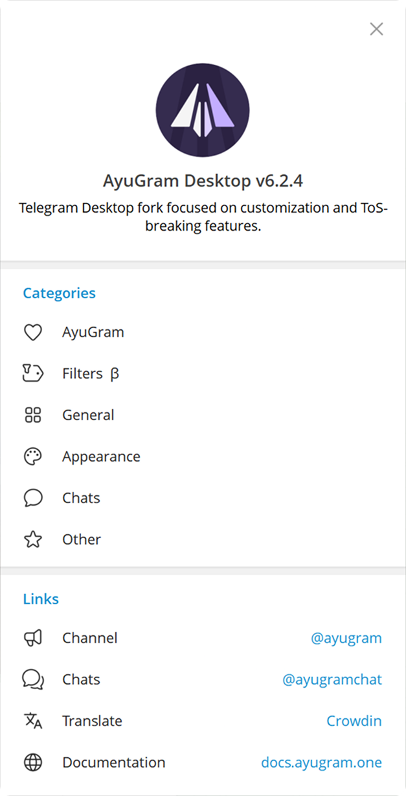
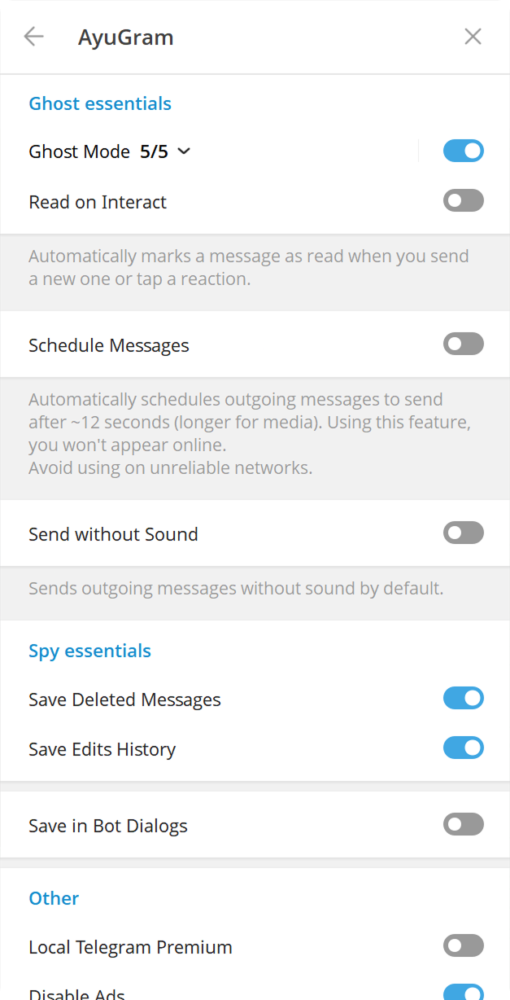
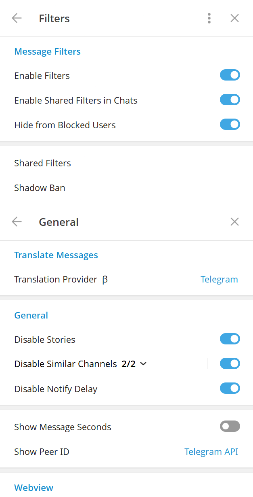
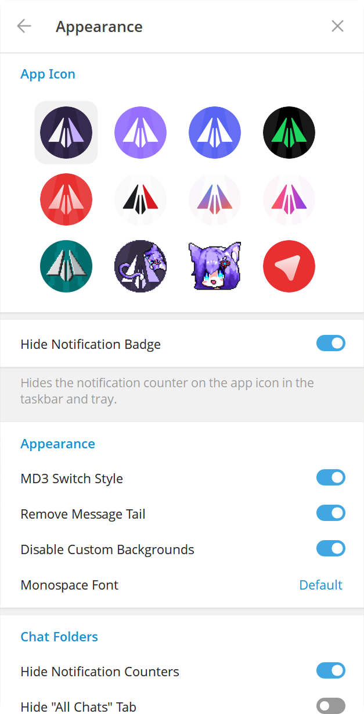
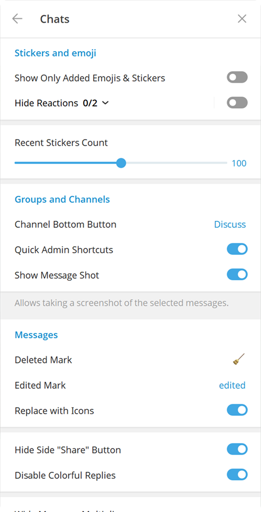

# Aqzelo Desktop


[ English  |  [Русский](README-RU.md) ]

A feature-rich Telegram Desktop fork focused on privacy, customization, and enhanced user experience.

## Features

- **Full Ghost Mode** (flexible) — read messages without sending read receipts
- **Messages History** — track deleted/edited messages
- **Anti-Recall** — prevent message deletion
- **Font Customization** — custom fonts, sizes, scaling
- **Streamer Mode** — hide sensitive info during streaming
- **Local Telegram Premium** — unlock premium features locally
- **Built-in Translator** — translate messages inline
- **Media Preview** — quick preview on force click (macOS)
- **Enhanced Appearance** — themes, animations, custom CSS

And many more. Check out our [FAQ](https://t.me/AqzeloFAQ) and [Channel](https://t.me/Aqzelo).

<details>
<summary>Screenshots</summary>
<table>
  <tr>
    <td></td>
    <td></td>
    <td></td>
  </tr>
  <tr>
    <td></td>
    <td></td>
  </tr>
</table>
</details>

## Downloads

### Windows

#### Official Releases
Download prebuilt binaries from the [Releases tab](https://github.com/motelyz/aqzelo/releases) or from the [Telegram channel](https://t.me/AqzeloReleases).

#### Package Managers
```bash
# Winget
winget install RadolynLabs.AqzeloDesktop

# Scoop
scoop bucket add extras
scoop install aqzelo
```

#### Self-Built
Follow the [Windows build guide](docs/building-win-x64.md) to build from source.

### macOS
Download from [Releases](https://github.com/motelyz/aqzelo/releases) or install via Homebrew:
```bash
brew install --cask aqzelo
```

### Linux
- **Arch Linux (AUR):** `aqzelo-desktop` / `aqzelo-desktop-bin`
- **NixOS:** `aqzelo-desktop` from [ndfined-crp/aqzelo-desktop](https://github.com/ndfined-crp/aqzelo-desktop)
- **Flatpak:** [AqzeloDesktop-flatpak](https://github.com/0FL01/AqzeloDesktop-flatpak)
- **Fedora:** `dnf install aqzelo-desktop` (RPM Fusion)
- **Other:** See [Linux build guide](docs/building-linux.md)

## Building from Source

### Windows (x64)
Requirements:
- Visual Studio 2022 Build Tools
- Qt 5.15.x (static)
- Python 3.12+
- Rust (for tlottie)
- Git with submodules

```cmd
# Clone with submodules
git clone --recursive https://github.com/motelyz/aqzelo.git
cd aqzelo

# Run build script
Telegram\build\prepare\win.bat
configure.bat x64 -D TDESKTOP_API_ID=2040 -D TDESKTOP_API_HASH=b18441a1ff607e10a989891a5462e627
cmake --build out --config Release --target Telegram
```

Or use the automated [GitHub Actions workflow](.github/workflows/build.yml) — push to `master` or create a tag to trigger builds.

### Linux/macOS
See [building-linux.md](docs/building-linux.md) and [building-mac.md](docs/building-mac.md).

## API Configuration

This fork uses the official Telegram API credentials by default. To use your own:
1. Get API ID/hash from [my.telegram.org](https://my.telegram.org)
2. Pass them during configure:
   ```cmd
   configure.bat x64 -D TDESKTOP_API_ID=YOUR_ID -D TDESKTOP_API_HASH=YOUR_HASH
   ```

## License

This project is licensed under the **GPL v3** — see [LICENSE](LICENSE) for details.

Aqzelo is a fork of:
- [AyuGram](https://github.com/AyuGram/AyuGramDesktop)
- [Telegram Desktop](https://github.com/telegramdesktop/tdesktop)

All upstream licenses apply.

## Credits

### Telegram Clients
- [Telegram Desktop](https://github.com/telegramdesktop/tdesktop)
- [AyuGram](https://github.com/AyuGram/AyuGramDesktop)
- [Kotatogram](https://github.com/kotatogram/kotatogram-desktop)
- [64Gram](https://github.com/TDesktop-x64/tdesktop)
- [Forkgram](https://github.com/forkgram/tdesktop)

### Libraries
- [JSON for Modern C++](https://github.com/nlohmann/json)
- [SQLite](https://github.com/sqlite/sqlite)
- [sqlite_orm](https://github.com/fnc12/sqlite_orm)
- [androidx sources](https://github.com/androidx/androidx)

### Icons
- [Solar Icon Set](https://www.figma.com/community/file/1166831539721848736)

### Bots
- [TelegramDB](https://t.me/tgdatabase) for username lookup by ID

## Support

- **Channel:** [@Aqzelo](https://t.me/Aqzelo)
- **FAQ:** [@AqzeloFAQ](https://t.me/AqzeloFAQ)
- **Issues:** [GitHub Issues](https://github.com/motelyz/aqzelo/issues)

---

**Maintainer:** [@motelyz](https://github.com/motelyz)